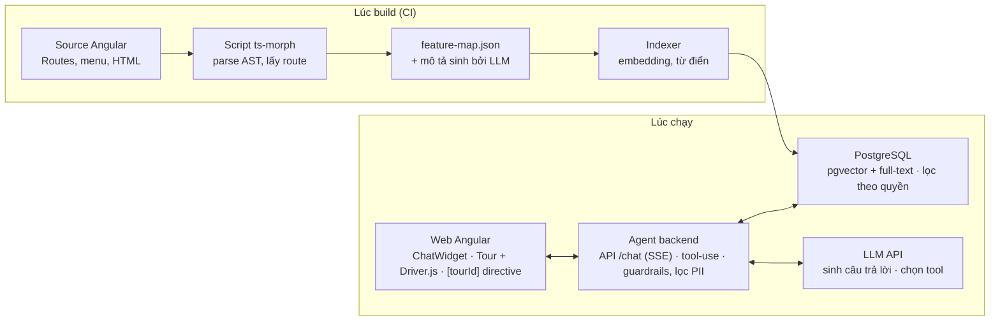

# WealthCompass – Plan kỹ thuật

*Tìm đúng tính năng, đi đúng từng bước.*

Cập nhật: 2026-10-02

## Tổng quan

WealthCompass là trợ lý AI nhúng vào web đầu tư (Angular), giúp người dùng tìm đúng tính năng bằng câu hỏi tự nhiên rồi dẫn tour từng bước ngay trên giao diện. Hệ thống gồm hai lớp: **tri thức** (feature map sinh từ source code, được embedding) và **hành động** (agent trả lời, điều hướng, highlight, chạy tour).

**Mục tiêu**

- Giảm thời gian tìm tính năng và số ticket hỗ trợ kiểu "làm X ở đâu".
- Tăng tỷ lệ hoàn thành các luồng quan trọng: đặt lệnh, nộp/rút tiền, mua chứng chỉ quỹ, bán lại trái phiếu.
- Thu dữ liệu câu hỏi để biết tính năng nào khó tìm.

**Phạm vi:** cổ phiếu, trái phiếu, chứng chỉ quỹ; phái sinh nếu web đã có.

**Ngoài phạm vi:** tự đặt lệnh hay điền form thay người dùng, nhập OTP, tư vấn mua/bán, báo giá realtime từ bộ nhớ của mô hình.

## Kiến trúc tổng thể



Lúc build, CI biến source Angular thành feature map và index vào PostgreSQL. Lúc chạy, widget gửi câu hỏi kèm ngữ cảnh cho agent; agent tìm trong index, gọi LLM, rồi trả về câu trả lời cùng lệnh điều hướng/tour để frontend thực thi.

## Giai đoạn 1: Feature map từ source Angular

Kết quả là file `feature-map.json`: mỗi màn hình một bản ghi có cấu trúc, sinh tự động từ code và cập nhật theo mỗi lần build.

**Cách trích**

1. Script Node.js dùng `ts-morph` parse AST các file `Routes[]`, đi theo `loadChildren` / `loadComponent` để lấy đủ route lazy-loaded.
2. Với mỗi route lấy: `path` đầy đủ, component, guard (`canActivate`), `data`.
3. Đọc file menu/sidebar config để lấy tên hiển thị và cây menu cha–con.
4. Quét template HTML tìm các phần tử có `tourId` để biết màn hình có những bước nào.
5. Dùng LLM sinh mô tả nghiệp vụ và câu hỏi mẫu cho màn hình chưa có `data.description`; người của nghiệp vụ duyệt lại.

**Chuẩn hóa `route.data`** (nguồn sạch nhất, sống cạnh code):

```ts
{ path: 'fund/subscribe', component: FundSubscribeComponent,
  canActivate: [fundAccountGuard],
  data: { title: 'Đăng ký mua chứng chỉ quỹ',
          description: 'Đặt lệnh mua CCQ mở theo phiên khớp',
          productType: 'fund', keywords: ['mua quỹ', 'CCQ', 'SIP'] } }
```

**Schema bản ghi**

| Trường | Ví dụ | Dùng để |
| --- | --- | --- |
| `id`, `route` | `fund.subscribe`, `/fund/subscribe` | Điều hướng |
| `title`, `description`, `keywords` | như trên | Embedding, tìm kiếm |
| `menuPath` | Quỹ › Giao dịch › Mua | Trả lời "ở đâu" |
| `productType` | stock / bond / fund / derivative | Lọc theo sản phẩm |
| `requiredRoles` | `fund_account` | Lọc theo quyền |
| `actions[]` | `{tourId, label, hint}` | Sinh bước tour |
| `sampleQuestions[]` | "mua quỹ ở đâu" | Tăng recall, làm test set |

**Đồng bộ:** chạy script trong CI. Route mới thiếu `title`/`description` thì CI cảnh báo; feature map đổi thì tự re-index.

## Giai đoạn 2: Indexing và tìm kiếm

Tìm kiếm dùng hybrid (vector + từ khóa) trên feature map đã lọc theo quyền, vì người dùng hay gõ mã và viết tắt (ATC, CCQ, UTTB) mà vector thuần dễ bỏ sót.

- **Chunk:** mỗi màn hình 1 document (title + description + menuPath + keywords + sampleQuestions). Màn hình lớn có nhiều tab thì tách theo tab.
- **Embedding:** mô hình đa ngôn ngữ hỗ trợ tiếng Việt tốt; chọn sau khi benchmark trên test set nội bộ.
- **Lưu trữ:** PostgreSQL + `pgvector` (đủ cho vài nghìn bản ghi, ít hạ tầng mới) kết hợp full-text search; Qdrant nếu sau này cần quy mô lớn.
- **Từ điển thuật ngữ:** bảng đồng nghĩa do nghiệp vụ duy trì ("ứng trước" = "UTTB" = "lấy tiền bán sớm"; "CCQ" = "chứng chỉ quỹ"). Dùng để mở rộng câu hỏi trước khi tìm.
- **Lọc trước khi tìm:** theo `requiredRoles` của user và `productType` nếu câu hỏi đã rõ sản phẩm.
- **Rerank:** lấy top 10, rerank còn top 3 đưa cho agent; điểm thấp hơn ngưỡng thì agent hỏi lại thay vì đoán.

## Giai đoạn 3: Agent backend

Agent là một service riêng (Node.js hoặc Python) gọi LLM qua API theo vòng tool-use; frontend chỉ nhận câu trả lời và các lệnh UI để thực thi.

**Ngữ cảnh gửi kèm mỗi câu hỏi:** route hiện tại, danh sách `tourId` đang hiển thị, role/loại tài khoản, ngôn ngữ. Không gửi số tài khoản, số dư, danh mục.

**Tools**

| Tool | Chạy ở | Việc làm |
| --- | --- | --- |
| `search_features(query)` | Backend | Hybrid search trên feature map đã lọc quyền |
| `get_feature(id)` | Backend | Lấy chi tiết, `actions[]` của một màn hình |
| `navigate(route)` | Frontend | Chuyển màn hình qua Angular Router |
| `highlight(tourId, text)` | Frontend | Nhấn mạnh một phần tử kèm chú thích |
| `start_tour(steps[])` | Frontend | Chạy tour nhiều bước, có thể qua nhiều màn hình |
| `handoff_support()` | Backend | Chuyển sang CSKH khi không trả lời được |

Tool frontend được trả về dưới dạng sự kiện trong stream; widget thực thi rồi báo kết quả (thành công / phần tử không tồn tại) về agent.

**Guardrails**

- System prompt: chỉ trả lời dựa trên kết quả `search_features`; không tìm thấy thì nói rõ và gợi ý CSKH.
- `tourId` và `route` agent trả về phải nằm trong feature map; backend kiểm tra trước khi gửi xuống frontend.
- Bộ phân loại đầu vào chặn câu hỏi tư vấn đầu tư ("nên mua mã nào"), trả lời theo mẫu do pháp chế duyệt.

**API:** `POST /api/compass/chat` trả SSE stream (text + sự kiện tool); xác thực bằng token phiên hiện có của web; rate limit theo user.

## Giai đoạn 4: Frontend Angular

Phần frontend đóng gói thành một thư viện nội bộ `@wealthcompass/ui` gồm 1 widget, 1 directive, 3 service, để tích hợp vào app chỉ cần import và đặt widget ở layout gốc.

- **`ChatWidgetComponent`:** nút nổi góc màn hình, khung chat, nhận SSE stream, hiển thị link điều hướng và nút "Dẫn tôi đi". Standalone component, dùng Angular CDK Overlay.
- **`TourIdDirective` (`[tourId]`):** gắn `data-tour-id` và đăng ký/hủy đăng ký phần tử với `TourRegistryService` theo vòng đời component.
- **`TourRegistryService`:** biết phần tử nào đang hiển thị; cung cấp `waitFor(tourId, timeout)` để tour chờ component render xong.
- **`TourService`:** bọc Driver.js. Với mỗi bước: `router.navigate()` nếu khác route → `waitFor(tourId)` → highlight. Bước lỗi thì bỏ qua và báo agent.
- **`CompassContextService`:** gom ngữ cảnh (route, role, tourId đang hiển thị) gửi kèm mỗi câu hỏi.

**Quy tắc cho màn hình giao dịch:** tour chỉ highlight và giải thích các ô; nút Đặt lệnh, Xác nhận, OTP được đánh dấu `tourRole="user-only"` — TourService không bao giờ click hay điền vào chúng.

**Tour ưu tiên (đợt 1):** đặt lệnh cổ phiếu (LO/ATO/ATC), nộp tiền, rút tiền, ứng trước tiền bán, mua chứng chỉ quỹ, bán lại trái phiếu, xem sao kê.

## Bảo mật và tuân thủ

Nguyên tắc gốc: WealthCompass chỉ dẫn đường, không giao dịch, không tư vấn, không đọc dữ liệu tài chính của khách.

- **Không thao tác giao dịch:** chặn ở cả hai lớp — agent không có tool đặt lệnh, và TourService không click/điền phần tử `user-only`.
- **Không tư vấn đầu tư:** bộ phân loại đầu vào + kiểm tra đầu ra; câu từ chối và disclaimer do pháp chế duyệt, đối chiếu quy định của UBCKNN.
- **Tối thiểu hóa dữ liệu gửi LLM:** chỉ câu hỏi + ngữ cảnh giao diện; lọc PII (số tài khoản, CCCD, số điện thoại) trước khi gửi. Xác nhận điều khoản nhà cung cấp LLM về không dùng dữ liệu để train và vị trí lưu trữ.
- **Không dữ liệu realtime từ bộ nhớ:** giá, sức mua, danh mục chỉ dẫn tới màn hình; nếu sau này cần trả lời thì gọi API nội bộ có phân quyền.
- **Chống prompt injection:** feature map và nội dung trang là dữ liệu, không phải lệnh; backend whitelist route/tourId.
- **Log:** lưu câu hỏi đã ẩn danh, kết quả tìm, tool đã gọi; thời hạn lưu theo chính sách nội bộ và Nghị định 13/2023 về bảo vệ dữ liệu cá nhân.

## Đo lường và vận hành

Mục tiêu cụ thể sẽ đặt sau 2 tuần đo baseline; dưới đây là bộ chỉ số cần thu từ ngày đầu.

| Chỉ số | Định nghĩa | Nguồn |
| --- | --- | --- |
| Retrieval hit@3 | Tỷ lệ câu hỏi trong test set có màn hình đúng nằm trong top 3 | Eval offline |
| Tỷ lệ tìm thấy | Câu hỏi agent trả lời được / tổng câu hỏi | Log |
| Tỷ lệ click điều hướng | User bấm link/"Dẫn tôi đi" / câu trả lời có link | Log frontend |
| Tỷ lệ hoàn thành tour | Tour chạy đến bước cuối / tour bắt đầu | Log frontend |
| Tỷ lệ tour lỗi | Bước không tìm thấy `tourId` | Log frontend |
| Thumbs up/down | Đánh giá của user cho từng câu trả lời | Widget |
| Ticket "ở đâu" | Số ticket CSKH về tìm tính năng, trước/sau | Hệ thống CSKH |
| Latency p95, chi phí/câu | Thời gian phản hồi và chi phí LLM | Backend |

**Vận hành**

- **Test set:** 200–300 câu hỏi thật (từ CSKH, sampleQuestions), mỗi câu gắn màn hình đúng; chạy mỗi lần đổi prompt/model/feature map.
- **E2E test tour:** Playwright chạy các tour ưu tiên trong CI, phát hiện `tourId` bị xóa.
- **Dashboard:** top câu hỏi không tìm thấy → bổ sung keyword/mô tả hoặc báo sản phẩm về tính năng khó tìm.
- **Feature flag:** bật theo nhóm user, tắt nhanh khi có sự cố.

## Lộ trình, nhân sự và nghiệm thu

Khoảng 17 tuần từ chuẩn bị đến pilot, qua 3 cổng kiểm soát.

| Giai đoạn | Thời lượng | Nội dung |
| --- | --- | --- |
| 0. Chuẩn bị | ~2 tuần | Chốt LLM cloud hay on-prem, pháp chế duyệt phạm vi, gom test set 200–300 câu hỏi thật |
| **Cổng 1** | | Pháp chế duyệt, chốt nhà cung cấp LLM |
| 1. Feature map | ~3 tuần | Script ts-morph, chuẩn hóa route.data, sinh mô tả bằng LLM, đưa vào CI |
| 2. Chatbot MVP | ~4 tuần | Indexing + agent backend + ChatWidget: trả lời và gửi link điều hướng, chưa có tour |
| **Cổng 2** | | hit@3 đạt ngưỡng trên test set, pilot nội bộ ổn |
| 3. Tour guide | ~4 tuần | Directive tourId, TourService + Driver.js, 7 tour ưu tiên, E2E Playwright |
| **Cổng 3** | | Tour ưu tiên pass E2E, không lỗi chặn |
| 4. Pilot và mở rộng | ~4 tuần | Bật theo nhóm user qua feature flag, theo dõi KPI, tối ưu từ log |

Thời lượng là ước tính cho đội nhỏ bên dưới (2 dev chính toàn thời gian); chatbot MVP ra trước để đo hiệu quả rồi mới đầu tư tour.

**Nhân sự tối thiểu**

- 1 frontend Angular: widget, directive, TourService.
- 1 backend/AI engineer: script feature map, indexing, agent, eval.
- QA bán thời gian: test set, E2E tour.
- Nghiệp vụ/CSKH bán thời gian: duyệt mô tả, từ điển thuật ngữ, câu hỏi mẫu.
- Pháp chế: duyệt phạm vi, mẫu từ chối, disclaimer.

**Tiêu chí nghiệm thu MVP**

- [ ] Feature map phủ 100% route có trên menu, sinh tự động trong CI.
- [ ] hit@3 trên test set đạt ngưỡng thống nhất ở Cổng 1.
- [ ] 0 trường hợp agent trả route/tourId ngoài feature map.
- [ ] 100% câu hỏi tư vấn đầu tư trong bộ test bị từ chối đúng mẫu.
- [ ] Latency p95 và chi phí/câu nằm trong ngân sách đã duyệt.

## Rủi ro và câu hỏi mở

| Rủi ro | Ảnh hưởng | Giảm thiểu |
| --- | --- | --- |
| Agent bịa tính năng/route không tồn tại | Mất niềm tin | Chỉ trả lời từ kết quả tìm; whitelist route/tourId ở backend |
| Tour gãy khi UI đổi | Trải nghiệm lỗi | `tourId` cố định, E2E test trong CI |
| User hỏi tư vấn đầu tư | Rủi ro pháp lý | Phân loại đầu vào, mẫu từ chối pháp chế duyệt |
| Lộ dữ liệu cá nhân sang LLM | Rủi ro pháp lý, uy tín | Lọc PII, không gửi dữ liệu tài khoản |
| Feature map lệch với code | Trả lời sai | Sinh trong CI, cảnh báo route thiếu mô tả |
| Chi phí LLM tăng theo lượt dùng | Ngân sách | Cache câu hỏi phổ biến, model nhỏ cho phân loại, rate limit |

**Câu hỏi mở**

- [ ] Phiên bản Angular và dự án dùng NgModule hay standalone components?
- [ ] Dùng LLM qua API cloud hay bắt buộc triển khai on-premise theo chính sách công ty?
- [ ] Pháp chế cần duyệt những nội dung nào trước khi pilot?
- [ ] Có được lấy dữ liệu ticket CSKH để làm test set không?
- [ ] Pilot với nhóm user nào (nội bộ, khách mới mở tài khoản…)?
