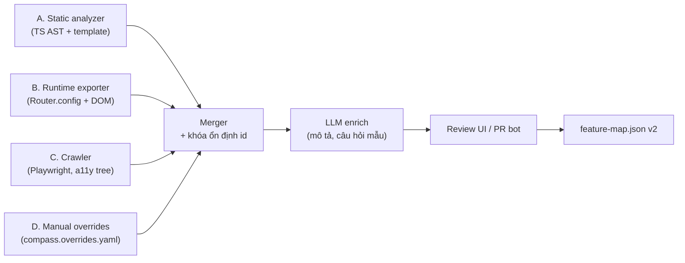

# WealthCompass – Plan kỹ thuật bản tổng quát (áp vào bất kỳ web Angular nào)

Cập nhật: 2026-10-03

Tài liệu này mở rộng [plan v1](technical-plan.md). Plan v1 đúng cho một web đầu tư cụ thể; bản này tách phần **nền tảng dùng chung** khỏi phần **đặc thù ngành**, để cùng một hệ thống gắn được vào web Angular khác (ngân hàng, bảo hiểm, ERP, admin, thương mại điện tử…) mà không viết lại.

## 1. Mục tiêu và nguyên tắc

"Áp vào bất kỳ web Angular nào" cần chia theo mức quyền truy cập, vì mỗi mức dùng một cách khác nhau:

| Mức | Tình huống | Cách tích hợp | Chất lượng kỳ vọng |
| --- | --- | --- | --- |
| **A** | Có source, sửa được | `ng add`, phân tích tĩnh, gắn `tourId` | Cao nhất |
| **B** | Có source, không sửa được (chỉ build) hoặc chỉ có bundle | Embed script + xuất route lúc chạy | Cao |
| **C** | Web của bên khác, không có source | Embed script + crawl bằng trình duyệt + selector tự chữa | Trung bình, tour kém bền |

**Nguyên tắc thiết kế**

1. **Hợp đồng trước, cài đặt sau.** Mọi thành phần nói chuyện qua 4 hợp đồng có version (mục 3). Thay thế một thành phần không phá các thành phần khác.
2. **Lõi không biết Angular.** Tour engine, bộ phân giải phần tử, client SSE viết bằng TypeScript thuần; Angular chỉ là adapter mỏng (Router, DI, directive). Nhờ vậy chạy được cả trên Angular cũ và trang không phải Angular.
3. **Nhiều nguồn khám phá, một Feature Graph.** Phân tích tĩnh, xuất route lúc chạy, crawl và khai báo tay đều đổ vào cùng một schema, có độ tin cậy và nguồn gốc.
4. **Ngành nghề là dữ liệu, không phải code.** Từ điển, guardrail, mẫu từ chối, quy tắc "chỉ người dùng được bấm" nằm trong *Domain Pack*. Bản đầu tư hiện tại trở thành pack `finance-vn`.
5. **Không biết thì nói không biết.** Mọi điểm không phân tích được đều ghi vào báo cáo độ phủ; agent chỉ dẫn tới thứ nằm trong Feature Graph (giữ nguyên guardrail whitelist của plan v1).
6. **An toàn mặc định ở mọi tenant:** agent không có tool ghi/giao dịch; engine không click phần tử nhạy cảm. Tenant chỉ siết thêm, không nới được quy tắc nền.

## 2. Plan v1 đang gắn cứng những gì, và tổng quát hóa thế nào

| Giả định trong v1 | Vấn đề khi sang web khác | Cách tổng quát hóa |
| --- | --- | --- |
| Có `route.data.title/description/productType` chuẩn hóa | Web khác không có, và không sửa được | Trích từ nhiều nguồn (tiêu đề menu, `<title>`, heading `h1`, LLM), cho phép khai báo qua `compass.overrides.yaml` thay cho sửa code |
| `productType`: stock/bond/fund | Là khái niệm của ngành đầu tư | Đổi thành `facets` tự do do Domain Pack định nghĩa (`{productType: 'fund'}`, `{module: 'hr'}`) |
| `requiredRoles` đọc từ guard | Guard là code tùy ý, không suy ra được ý nghĩa | Ánh xạ guard → quyền trong config; guard lạ ghi `accessUnknown` |
| Directive `[tourId]` trên mọi phần tử | Không sửa được template | Cascade bộ chọn: `data-tour-id` → `data-testid` → `id` → role + tên → nhãn/text → vân tay DOM |
| Widget + Driver.js gắn bằng import | Angular cũ, NgModule, hoặc không sửa được app | Hai đường phân phối: thư viện Angular và script embed (Web Component) |
| Một backend, một LLM, một bộ index | Mỗi khách có dữ liệu, chính sách riêng | Backend đa tenant, cô lập dữ liệu, tuỳ chọn tự host một tenant |
| Disclaimer, phân loại "tư vấn đầu tư" | Chỉ đúng cho tài chính | Chính sách là thành phần của Domain Pack (`generic` có bộ tối thiểu) |
| Tiếng Việt | Tenant khác dùng ngôn ngữ khác | Locale theo tenant; embedding đa ngôn ngữ; prompt và mẫu từ chối theo locale |

## 3. Bốn hợp đồng (viết trước, version hóa)

Đặt trong package `@wealthcompass/contracts` (JSON Schema + kiểu TypeScript sinh từ schema). Đổi hợp đồng theo semver; backend hỗ trợ N-1.

### 3.1 Feature Map v2

```jsonc
{
  "schemaVersion": "2",
  "tenantId": "acme",
  "appVersion": "2026.10.1",          // phiên bản web, để index theo bản phát hành
  "generatedAt": "2026-10-03T08:00:00Z",
  "features": [{
    "id": "fund.subscribe",            // ổn định giữa các lần build, xem mục 4.6
    "route": { "pattern": "/fund/subscribe/:fundId", "exampleParams": { "fundId": "VCBF-BCF" } },
    "title": "Đăng ký mua chứng chỉ quỹ",
    "description": "…",
    "keywords": ["mua quỹ", "CCQ"],
    "menuPath": ["Quỹ", "Giao dịch", "Mua"],
    "facets": { "productType": "fund" },
    "access": { "requires": ["fund_account"], "unknownGuards": [] },
    "targets": [{ "tourId": "fund-amount", "label": "Số tiền", "hint": "…",
                  "locator": { "strategies": ["testid", "role-name", "css"], "css": "app-fund-form #amount" },
                  "sensitivity": "normal" }],   // normal | user-only
    "sampleQuestions": ["mua quỹ ở đâu"],
    "provenance": { "source": ["static", "runtime"], "confidence": 0.92, "reviewed": true,
                    "sourceRef": "src/app/fund/fund.routes.ts:12" }
  }],
  "coverage": { "routesFound": 84, "routesWithTitle": 71, "menuItemsMatched": 66, "warnings": [] }
}
```

### 3.2 Context protocol (frontend → agent)

```jsonc
{ "route": "/fund/subscribe/VCBF-BCF", "routePattern": "/fund/subscribe/:fundId",
  "visibleTargets": ["fund-amount", "fund-submit"], "locale": "vi",
  "capabilities": ["fund_account"],      // đã qua ánh xạ của tenant, không phải token thô
  "ui": { "hasOpenDialog": false, "viewport": "desktop" } }
```

Không bao giờ gửi giá trị trong ô nhập, số dư, danh mục, token.

### 3.3 Tool và event protocol (agent ↔ widget qua SSE)

Sự kiện: `text`, `navigate`, `highlight`, `start_tour`, `ask_user_to_act`, `handoff`, `done`. Widget trả về `tool_result` với `status: ok | target_missing | blocked_user_only | route_denied | timeout`. Backend kiểm tra whitelist `route` và `tourId` theo Feature Map của tenant trước khi phát sự kiện.

Thêm so với v1: **`ask_user_to_act`** ("hãy bấm vào ô này") cho các bước cần người dùng thao tác (mở dropdown, chọn tab, nhập OTP) và tour tự tiến khi nhận được sự kiện thật từ người dùng.

### 3.4 Tenant config (`compass.config.ts` hoặc JSON)

```ts
export default defineCompass({
  tenantId: 'acme',
  domainPack: '@wealthcompass/pack-generic',      // hoặc pack-finance-vn
  locale: 'vi',
  backend: { baseUrl: 'https://compass.example.com', auth: 'host-token' },
  identity: {                                       // lấy quyền từ app, không tự suy ra
    capabilities: (ctx) => ctx.injector.get(AuthService).roles(),
  },
  access: { guards: { fundAccountGuard: { requires: ['fund_account'] } } },
  discovery: { entry: 'src/app/app.routes.ts', menu: 'src/app/layout/menu.config.ts' },
  safety: {
    userOnly: ['[data-sensitive]', 'input[type=password]', 'button[type=submit]'],
    blockedRoutes: ['/settings/security']
  },
  pii: { patterns: ['phone-vn', 'national-id-vn', 'iban'] },
  ui: { theme: { primary: '#0a7' }, position: 'bottom-right' }
});
```

## 4. Tầng khám phá (Discovery): từ source/app ra Feature Graph

Mỗi bộ khám phá là một plugin, đầu ra là `PartialFeatureMap`; bộ **merger** gộp theo thứ tự ưu tiên `manual > static > runtime > crawl > llm` cho từng trường, giữ `provenance`.



### 4.1 Tầng A – Phân tích tĩnh (mức A, B có source)

Dùng `ts-morph` trên TypeScript compiler API, **không phụ thuộc phiên bản Angular** cho phần route; chỉ phần template cần parser riêng.

Phải nhận diện đủ các kiểu khai báo route đang tồn tại:

- NgModule: `RouterModule.forRoot(routes)`, `forChild(routes)`.
- Standalone: `provideRouter(routes)`, `bootstrapApplication(App, { providers })`, `ROUTES` token, `loadChildren: () => import('./x.routes').then(m => m.ROUTES)`, `loadComponent`.
- `Routes` khai báo ở biến khác file, spread (`...adminRoutes`), hàm tạo route, hằng số đường dẫn (`path: ROUTE_PATHS.fund`). Dùng type checker để resolve; nếu không resolve được thì ghi cảnh báo thay vì đoán.
- `redirectTo`, `**`, `canMatch`, `children` rỗng với `component`, named outlet (`outlet: 'popup'`), `data` và `title` (kể cả `title` là resolver).

Template: dùng `angular-html-parser` (không gắn với phiên bản compiler) thay cho `@angular/compiler`, chỉ lấy cấu trúc cần: `routerLink`, `[routerLink]`, heading, `label`, `button`, `aria-*`, `data-testid`, `tourId`. Cú pháp control flow mới (`@if`, `@for`) và cũ (`*ngIf`) đều phải parse được; phần không parse được bỏ qua kèm cảnh báo.

Phát hiện menu theo thứ tự: (1) file cấu hình chỉ định trong config; (2) heuristic tìm mảng đối tượng có `route|path|link|url` + `label|title|name` + `children|items`; (3) template có `routerLink` trong `nav|aside|mat-nav-list|p-menu…`; (4) bỏ qua, để tầng B bổ sung.

Guard → quyền: bảng `access.guards` trong config; guard không có trong bảng thì ghi `unknownGuards`. Khi agent gặp màn hình có `unknownGuards`, trả lời "màn hình này có thể cần thêm quyền".

Route tham số (`:id`): cần `exampleParams` để tour chạy được; thiếu thì tính năng vẫn tìm thấy nhưng chỉ dẫn tới danh sách cha, không điều hướng thẳng.

### 4.2 Tầng B – Xuất route lúc chạy (mức B, không sửa được source)

Đây là nguồn sự thật trung lập nhất vì chạy trên chính app đã build.

- Provider `provideCompassExporter()` (hoặc script embed) đọc `Router.config`, đi đệ quy; với `loadChildren`/`loadComponent` gọi hàm import để lấy route lazy (an toàn vì chỉ tải module, không điều hướng). Không dùng API private của Router (`_loadedRoutes`) để khỏi gãy theo phiên bản.
- Đọc tiêu đề, `routerLink` hiện có trong DOM sau khi app render (menu thực tế đúng với quyền người dùng đang đăng nhập).
- Chạy trong CI bằng Playwright với tài khoản kiểm thử theo từng vai trò → ra Feature Map theo vai trò, gộp thành `access.requires` thực nghiệm (route nào vai trò nào vào được).
- Micro-frontend/Module Federation: route của remote không có trong source host; tầng B là nguồn duy nhất cho phần này.

### 4.3 Tầng C – Crawl hộp đen (mức C)

Playwright đăng nhập bằng tài khoản kiểm thử do chủ web cung cấp, đi theo link trong menu, ghi lại cây truy cập (accessibility tree) của từng màn hình: tiêu đề, nút, ô nhập, nhãn. Sinh `targets` với locator `role-name` làm chính.

Ràng buộc: chỉ crawl domain đã xác minh sở hữu (DNS TXT hoặc file `/.well-known/compass.txt`); tốc độ giới hạn; không bấm nút ngoài danh sách cho phép; không nhập vào form. Crawl là chế độ chất lượng thấp nhất nên mặc định `confidence` thấp và bắt buộc có người duyệt trước khi dùng cho tour.

### 4.4 Tầng D – Khai báo tay

`compass.overrides.yaml` nằm cạnh code (hoặc tải qua UI quản trị): đổi tiêu đề, thêm từ khóa, ẩn route, gắn `sensitivity`, ánh xạ locator. Là cách duy nhất cho mức C sửa sai và là cách để nghiệp vụ không cần động vào code Angular.

### 4.5 Làm giàu bằng LLM

Chỉ để điền chỗ trống (mô tả, câu hỏi mẫu, từ khóa) cho feature chưa `reviewed`. Đầu vào là Feature Map đã có và text công khai trên giao diện, không có dữ liệu người dùng. Đầu ra luôn gắn `provenance.source = llm` và đi qua bước duyệt (PR bot mở pull request vào file overrides, người duyệt chấp nhận).

### 4.6 Khóa ổn định và đổi tên

`id` không được đổi khi route đổi tên, nếu không log, đánh giá, tour đã lưu đều mất. Quy tắc: `id` lấy từ `data.compassId` hoặc overrides; nếu không có, sinh từ đường dẫn component + route, rồi lưu vào `compass.lock.json` ngay lần quét đầu; lần sau khớp theo (component, route) rồi mới tạo id mới và cảnh báo khi có cặp "mất – mới" nghi là đổi tên.

### 4.7 Báo cáo độ phủ

CLI `compass doctor` in: số route tìm thấy / có tiêu đề / có trên menu / có target; route không resolve được; guard chưa ánh xạ; template không parse được. Đây là tiêu chí để quyết định mức A/B/C phù hợp với web đó và là chỉ số nghiệm thu khi onboard tenant.

## 5. Tầng chạy trên trình duyệt

### 5.1 Chia gói

| Gói | Nội dung | Phụ thuộc |
| --- | --- | --- |
| `@wealthcompass/core` | `TargetResolver`, `TourEngine`, `SseClient`, `ContextBuilder`, `PiiFilter`, `SafetyPolicy` | Không có framework |
| `@wealthcompass/angular` | `provideCompass()`, `CompassModule`, `ChatWidgetComponent`, `[tourId]`, `RouterAdapter` | `@angular/*` theo peerDependencies |
| `@wealthcompass/embed` | Web Component `<wealthcompass-widget>` đóng gói 1 file JS | Không có framework |
| `@wealthcompass/cli` | `init`, `scan`, `doctor`, `publish`, `eval` | Node |

### 5.2 Tương thích phiên bản Angular

- Thư viện biên dịch ở chế độ **partial compilation** (Angular Package Format), nên một bản build chạy được trên nhiều phiên bản Angular; `peerDependencies` khai báo dải `>=16 <24`. Hiện Angular 22 là bản mới nhất (7/2026), 21 và 20 còn hỗ trợ; từ sau 22 Angular chuyển sang chu kỳ major 12 tháng nên dải phiên bản cần rà lại mỗi năm.
- **Angular 14–15** (standalone còn ở dạng đầu): hỗ trợ bằng đường embed + exporter, không bắt buộc thư viện Angular.
- **Angular dưới 14 và AngularJS/khác**: chỉ đường embed (Web Component) và tầng C; không cam kết exporter.
- Bắt buộc kiểm thử với: NgModule và standalone; zone.js và zoneless; signals; SSR/hydration (mọi truy cập `window`/`document` bọc `isPlatformBrowser`); `HashLocationStrategy`; `<base href>` khác `/`; route theo locale (`/vi/...`).
- Không dùng API Angular private/không ổn định. `RouterAdapter` chỉ dùng `Router.navigateByUrl`, `Router.events`, `Router.config`.

### 5.3 Cài đặt vào app (`ng add`)

Schematic `ng add @wealthcompass/angular`:

1. Phát hiện NgModule hay standalone (đọc `main.ts`, `app.config.ts`) → chèn `provideCompass(config)` hoặc `CompassModule.forRoot(config)`.
2. Thêm `<wealthcompass-widget>` vào component gốc, hoặc đăng ký động qua Overlay để không đổi template.
3. Tạo `compass.config.ts` và `compass.overrides.yaml` mẫu.
4. Chạy `compass doctor` và in kết quả.
5. Không bao giờ ghi đè file có sẵn; chỉ thêm, và in diff để người dùng xem.

Lỗi schematic không được làm hỏng app: nếu không nhận diện được cấu trúc, in hướng dẫn thủ công thay vì tự sửa bừa.

Đường embed: 

```html
<script src="https://cdn.example.com/compass/v1/embed.js"
        data-tenant="acme" data-token-endpoint="/api/compass/token" async></script>
```

### 5.4 Phân giải phần tử (`TargetResolver`) và tự chữa

Bộ phân giải thử lần lượt theo `locator.strategies`:

1. `data-tour-id` (hoặc directive `[tourId]`)
2. `data-testid` / `data-cy` / `data-qa`
3. `id` ổn định (bỏ id sinh tự động kiểu `mat-input-3`)
4. Role + tên truy cập (`button "Đặt lệnh"`)
5. Nhãn `<label for>`, `aria-label`, `placeholder`, text gần nhất
6. CSS tương đối từ vùng chứa component (`app-fund-form #amount`), tránh `nth-child` dài
7. **Vân tay DOM** (thẻ, class bền, text, vị trí tương đối trong vùng cha) và so khớp mờ

Quy tắc:

- Trả về cả `matchedBy` và `score`; dưới ngưỡng thì **không highlight**, báo `target_missing` thay vì chỉ sai chỗ.
- Locator tốt nhất đã thấy được ghi lại phía client và gửi lên log (không kèm nội dung ô nhập) để CI đề xuất cập nhật khi UI đổi ("self-healing có người duyệt", không tự sửa vào config).
- Hỗ trợ phần tử trong overlay của Material/CDK (`.cdk-overlay-container`), `shadowRoot` mở, và iframe cùng origin. Iframe khác origin và shadow DOM đóng: **không** hỗ trợ, báo `target_unreachable`. Không dựa vào việc Driver.js xử lý các trường hợp này; kiểm thử riêng trước khi cam kết.
- Chờ phần tử bằng `MutationObserver` + timeout, không dùng `setTimeout` cố định; hiểu `ChangeDetection` chưa kịp render và `*ngIf` async.

### 5.5 Tour engine

- Giao diện `TourRenderer` tách khỏi engine; mặc định cài bằng **Driver.js** (MIT, bản 1.3.x), có thể thay bằng renderer tự viết nếu gặp giới hạn. Style của tour/overlay cô lập bằng Shadow DOM hoặc tiền tố CSS để không đụng CSS của web chủ và ngược lại.
- Loại bước: `navigate`, `highlight`, `wait_for`, `ask_user_to_act`, `explain`. Mỗi bước có `onMissing: skip | stop | ask_agent`.
- Với phần tử cần tương tác trước khi hiện (dropdown, tab, accordion, dialog): bước `ask_user_to_act` thay vì engine tự click; engine nghe sự kiện thật rồi tự tiến.
- Điều hướng giữa màn hình dùng `RouterAdapter`; chịu được guard chặn điều hướng (báo `route_denied`, agent giải thích cần quyền gì) và redirect đăng nhập.
- Tour bị gián đoạn (user đóng, reload, mất phiên) lưu trạng thái trong `sessionStorage` để tiếp tục.
- Tôn trọng `prefers-reduced-motion`, điều khiển bằng bàn phím, `aria-live` cho nội dung bước; z-index không đè lên dialog bảo mật của web chủ.

### 5.6 An toàn phía client (áp cho mọi tenant)

`SafetyPolicy` hợp nhất theo thứ tự: quy tắc nền (không tắt được) + Domain Pack + cấu hình tenant. Mặc định coi là `user-only` và **không bao giờ** click/điền/focus bằng engine:

- `input[type=password]`, ô OTP (`autocomplete=one-time-code`, tên chứa `otp`/`pin`), ô thẻ (`cc-*`).
- `button[type=submit]` và nút nằm trong `<form>` trên route thuộc `blockedRoutes`.
- Mọi phần tử tenant gắn `data-sensitive` hoặc `sensitivity: user-only`.

Engine chỉ highlight và đọc; tool ghi như click, điền, gửi form **không tồn tại** trong giao thức (3.3), nên kể cả prompt injection cũng không có đường thực thi.

## 6. Backend đa tenant

### 6.1 Mô hình tenant và cô lập

- Mọi bảng có `tenant_id`; bật Row-Level Security của PostgreSQL với `SET app.tenant_id` mỗi request; test tự động kiểm tra truy vấn chéo tenant phải trả rỗng.
- Bảng chính: `tenants`, `tenant_configs`, `feature_map_versions`, `features`, `feature_embeddings (pgvector)`, `glossary_terms`, `domain_pack_versions`, `conversations` (đã ẩn danh), `feedback`, `usage_events`, `eval_runs`.
- Index theo **phiên bản phát hành**: mỗi lần publish Feature Map tạo `feature_map_versions` mới, chạy eval, đạt ngưỡng mới chuyển con trỏ `active`. Rollback là đổi lại con trỏ. Môi trường staging/prod của tenant dùng version khác nhau.

### 6.2 Xác thực và định danh người dùng cuối

Backend không giữ mật khẩu hay phiên của web chủ. Hai chế độ:

1. **Token trao đổi (khuyến nghị):** backend của web chủ gọi `POST /v1/session` bằng secret của tenant, nhận token ngắn hạn (5–15 phút) chứa `sub` đã băm, `capabilities`, `locale`. Widget dùng token này; quyền do web chủ quyết định, không do frontend tự khai.
2. **Xác minh JWT của web chủ:** tenant đăng ký JWKS URL; backend tự xác minh. Phù hợp khi web đã có JWT sẵn.

Chế độ ẩn danh (web công khai, chưa đăng nhập) dùng khóa công khai + danh sách `origin` cho phép + rate limit theo IP/fingerprint, và chỉ truy cập được tính năng có `access.requires` rỗng.

Mọi kết nối: kiểm tra `Origin` với allowlist của tenant, CORS chặt, khóa API không có quyền ghi Feature Map.

### 6.3 API

| Endpoint | Việc làm |
| --- | --- |
| `POST /v1/session` | Đổi secret tenant lấy token người dùng cuối |
| `POST /v1/chat` (SSE) | Hội thoại, phát sự kiện theo giao thức 3.3 |
| `POST /v1/tool-result` | Widget báo kết quả bước tour |
| `POST /v1/feedback` | Thumbs, lý do |
| `POST /v1/telemetry` | Sự kiện tour/click (đã lọc) |
| `PUT /v1/admin/feature-map` | CI publish (khóa admin riêng) |
| `GET /v1/admin/eval/:run` | Kết quả eval trước khi kích hoạt |

### 6.4 LLM và chi phí

- Lớp `LlmProvider` trừu tượng (cloud API hoặc on-prem tương thích OpenAI); cấu hình theo tenant, hỗ trợ khóa riêng của tenant (BYOK) và vùng lưu trữ dữ liệu.
- Hai bậc mô hình: nhỏ cho phân loại đầu vào và viết lại câu hỏi, lớn cho agent; cache ngữ nghĩa cho câu hỏi phổ biến (khóa theo tenant + version Feature Map + locale + quyền).
- Ngân sách và hạn mức theo tenant (token/ngày, câu/phút); vượt ngưỡng thì hạ cấp (tắt rerank, dùng mô hình nhỏ) thay vì lỗi cứng.
- Chế độ **tự host một tenant**: một `docker compose`/Helm chart gồm backend, Postgres, worker indexing; tắt các tính năng nhiều tenant. Dành cho khách yêu cầu on-prem như câu hỏi mở trong v1.

### 6.5 Tìm kiếm

Giữ nguyên hybrid vector + từ khóa của v1, thêm:

- Từ điển thuật ngữ nhiều tầng: pack (chung ngành) → tenant (riêng). Từ ghép tiếng Việt, viết tắt, không dấu đều được chuẩn hóa trước khi tìm.
- Bộ lọc theo `capabilities` và `facets` từ cấu hình.
- Ngưỡng điểm theo tenant, vì phân bố điểm khác nhau giữa miền; xác định bằng eval, không dùng một hằng số chung.

## 7. Domain Pack

Pack là gói dữ liệu có version, cài vào tenant:

```
pack-finance-vn/
  pack.yaml            # tên, locale, phiên bản, tương thích contracts
  glossary.yaml        # CCQ = chứng chỉ quỹ, UTTB = ứng trước tiền bán …
  policy/
    topics.yaml        # chủ đề bị chặn: tư vấn đầu tư, dự đoán giá …
    refusals.vi.md     # mẫu từ chối đã duyệt
    disclaimers.vi.md
  safety.yaml          # selector user-only bổ sung (nút Đặt lệnh, Xác nhận)
  facets.yaml          # productType: stock | bond | fund | derivative
  prompts/             # system prompt theo vai trò
  eval/seed-questions.yaml
```

Gói đi kèm: `pack-generic` (chỉ an toàn nền + glossary rỗng), `pack-finance-vn` (chuyển từ v1). Pack mới cho ngành khác chỉ là dữ liệu + eval seed, không sửa code. Pack được kiểm tra schema khi cài và chạy eval seed trước khi kích hoạt.

Phần nào của v1 chuyển đi đâu: guardrail đầu tư → `pack-finance-vn/policy`; ánh xạ `productType` → `facets`; tour ưu tiên (đặt lệnh, nộp/rút tiền…) → file tour mẫu của pack, tenant có thể ghi đè.

## 8. CLI và quy trình onboard một web mới

Mục tiêu: một web Angular mới đạt "chat tìm được đường" trong **dưới nửa ngày** (mức A/B), tour thêm theo từng luồng.

```
npx @wealthcompass/cli init        # hỏi mức A/B/C, phát hiện cấu trúc, tạo config
npx @wealthcompass/cli scan        # chạy tầng A (+B nếu có app chạy được), in báo cáo độ phủ
npx @wealthcompass/cli doctor      # kiểm tra phiên bản, CSP, router, guard chưa ánh xạ
npx @wealthcompass/cli publish     # đẩy Feature Map lên backend, kích hoạt nếu eval đạt
npx @wealthcompass/cli eval        # chạy bộ câu hỏi, in hit@3
npx @wealthcompass/cli tour:record # ghi tour bằng cách bấm trên app, sinh bước + locator
```

`tour:record` là cách chính để thêm tour cho web không sửa được: mở app trong Playwright, người vận hành bấm qua các bước, công cụ lưu locator theo cascade 5.4 và đề xuất `label`/`hint` (LLM), rồi người vận hành duyệt. Giảm nhu cầu gắn `tourId` bằng tay.

Quy trình:

1. `init` → chọn mức, nhập thông tin tenant, chọn pack.
2. `scan` → xử lý cảnh báo trong `doctor` (ánh xạ guard, thêm overrides).
3. Viết 20–30 câu hỏi thật (hoặc dùng seed của pack) → `eval` đạt ngưỡng.
4. `publish` lên staging, bật widget cho nhóm nội bộ qua feature flag.
5. Ghi 3–5 tour quan trọng bằng `tour:record`, thêm vào E2E.
6. Mở rộng theo log "câu hỏi không tìm thấy".

## 9. Kiểm thử để chứng minh tính tổng quát

Tổng quát chỉ đáng tin khi có bằng chứng trên nhiều app khác nhau, nên đây là hạng mục riêng chứ không phải việc phụ.

**Ma trận fixture** (app Angular mẫu nhỏ, chạy trong CI):

| Fixture | Mục đích |
| --- | --- |
| Angular 16 + NgModule + Material | Đường NgModule, lazy module |
| Angular 18 + standalone + PrimeNG | `provideRouter`, `loadComponent` |
| Angular 22 + zoneless + signals + control flow mới | Không phụ thuộc zone.js, template mới |
| Nx monorepo nhiều app/lib | Route khai báo trong lib, alias path |
| Module Federation (host + 2 remote) | Chỉ tầng B thấy được remote |
| SSR + hydration | Không vỡ khi render server |
| Hash routing + `<base href="/app/">` + route theo locale | Điều hướng và tour |
| App giả vờ không có source (chỉ bundle prod) | Mức B/C |

**Kho kiểm thử thực tế:** thêm một số app Angular mã nguồn mở có UI phức tạp (admin template, ứng dụng mẫu RealWorld…) để lấy điểm khi không do chính mình viết.

**Chỉ số tổng quát hóa** (đo theo từng fixture, in ở CI):

- Độ phủ route: số route tìm đúng / số route thật (có danh sách chuẩn của fixture).
- Độ phủ menu và độ chính xác `menuPath`.
- Tỷ lệ tour tự chữa thành công khi đổi class/DOM (mutation test: đổi tên class, bọc thêm thẻ, đổi thứ tự).
- hit@3 trên ít nhất **hai bộ câu hỏi ngoài ngành tài chính** (ví dụ ERP, thương mại điện tử) để tránh chỉnh tham số riêng cho tài chính.
- Tỷ lệ phần tử `user-only` bị engine chạm vào: bắt buộc bằng 0.

**Kiểm thử an toàn đa tenant:** truy vấn chéo tenant, dùng token tenant A với dữ liệu tenant B, Origin không có trong allowlist, prompt injection nằm trong `description` của Feature Map và trong nội dung trang crawl.

## 10. Bảo mật bổ sung cho bản tổng quát

| Rủi ro mới | Giảm thiểu |
| --- | --- |
| Rò dữ liệu giữa tenant | RLS, test chéo tenant, khóa mã hóa theo tenant cho log, cache khóa theo tenant |
| Prompt injection từ nội dung trang/crawl/Feature Map | Coi là dữ liệu; chuẩn hóa và cắt độ dài; whitelist route/tourId; agent không có tool ghi |
| XSS qua text trong Feature Map hiển thị ở widget | Render chỉ text/markdown đã lọc, không `innerHTML` thô, `DOMPurify` với danh sách thẻ hẹp |
| Embed script bị giả mạo/đổi nội dung | Phân phối kèm SRI, version cố định, ký bản phát hành |
| CSP của web chủ chặn widget | `doctor` kiểm tra `script-src`, `connect-src`, `style-src`; tài liệu hóa nonce; không dùng `eval` |
| Crawl nhầm web không thuộc sở hữu | Xác minh quyền sở hữu domain, giới hạn tốc độ, danh sách cho phép |
| PII khác nhau theo quốc gia | Bộ mẫu PII theo pack/locale, cho tenant bổ sung; lọc ở client trước khi gửi và ở backend |
| Web chủ đổi UI làm tour trỏ sai chỗ | Điểm khớp tối thiểu, báo `target_missing`, CI chạy tour định kỳ trên staging |

## 11. Lộ trình điều chỉnh

Thứ tự thay đổi so với v1: dựng **hợp đồng và discovery tổng quát trước**, chatbot chạy được trên **hai web khác nhau** rồi mới làm tour sâu. Đội giả định 2–3 dev (1 frontend Angular, 1 backend/AI, thêm 1 dev công cụ/CLI từ giai đoạn G2), QA và nghiệp vụ bán thời gian. Ước tính khoảng 24 tuần; mỗi cổng có tiêu chí thoát.

| Giai đoạn | Thời lượng | Nội dung | Tiêu chí thoát |
| --- | --- | --- | --- |
| **G0. Hợp đồng và khung** | ~2 tuần | `contracts` (4 hợp đồng + JSON Schema), monorepo, 3 fixture đầu (NgModule, standalone, zoneless), quyết định ADR | Schema được review; fixture chạy trong CI |
| **G1. Discovery A + B** | ~4 tuần | Static analyzer, exporter, merger, lock id, `doctor`, báo cáo độ phủ | Độ phủ route ≥ 95% trên cả 3 fixture; có 2 app thật chạy được |
| **Cổng 1** | | Pháp chế duyệt phạm vi, chốt nhà cung cấp LLM, chốt mô hình tenant | |
| **G2. Backend đa tenant + chatbot MVP** | ~5 tuần | Tenant, RLS, session token, indexing theo version, hybrid search, agent, widget (embed + Angular), `ng add` | Chat tìm đúng đường trên **2 web khác ngành**; hit@3 đạt ngưỡng |
| **Cổng 2** | | Pilot nội bộ ổn, kiểm thử chéo tenant pass | |
| **G3. Tour engine tổng quát** | ~5 tuần | `TargetResolver` + tự chữa, `TourRenderer`, `ask_user_to_act`, `tour:record`, SafetyPolicy, E2E Playwright | Tour mẫu pass trên mọi fixture; mutation test đạt ngưỡng; 0 chạm `user-only` |
| **Cổng 3** | | | |
| **G4. Domain Pack + tầng C** | ~3 tuần | Chuyển v1 thành `pack-finance-vn`, `pack-generic`, crawler, xác minh domain | Pack cài/gỡ không sửa code; crawler tạo Feature Map cho app giả "không source" |
| **G5. Pilot đa web** | ~5 tuần | Bật cho 2 web thật (1 tài chính, 1 ngoài ngành) qua feature flag, tối ưu từ log, tài liệu onboard | KPI baseline, tỷ lệ hoàn thành tour, onboard web thứ ba trong < 1 ngày |

G2 và G3 có thể chồng một phần nếu đủ người; không nên rút ngắn G0 vì sai hợp đồng là lỗi đắt nhất.

## 12. Quyết định kiến trúc (ADR) đề xuất

| # | Quyết định | Lý do | Đánh đổi |
| --- | --- | --- | --- |
| 1 | Lõi TS thuần + adapter Angular mỏng | Chạy cả Angular cũ và không phải Angular; thay renderer dễ | Thêm một lớp trừu tượng |
| 2 | Phân tích tĩnh bằng `ts-morph` + `angular-html-parser`, không dùng `@angular/compiler-cli` | Không ràng buộc phiên bản Angular của web | Tự viết nhiều heuristic hơn; không hiểu mọi template phức tạp |
| 3 | Route lúc chạy lấy từ `Router.config` công khai | Ổn định giữa các phiên bản, đúng với bản đã build | Cần chạy được app; route lazy phải tải được |
| 4 | Thư viện Angular dùng partial compilation, peer `>=16` | Một bản build phủ nhiều major | Phải kiểm thử ma trận phiên bản |
| 5 | Embed Web Component + Shadow DOM | Không ràng buộc framework, cô lập CSS | Giao tiếp với Router của Angular qua adapter/sự kiện |
| 6 | Renderer tour qua interface, mặc định Driver.js | Nhanh có sản phẩm; thay được nếu giới hạn (shadow DOM, iframe) | Phụ thuộc thư viện ngoài cho giai đoạn đầu |
| 7 | Một DB đa tenant với RLS, không tách DB theo tenant | Rẻ, dễ vận hành khi số tenant còn ít | Khách yêu cầu tách cứng dùng chế độ tự host |
| 8 | Quyền do web chủ cấp qua token, không tự suy từ guard | Guard là code tùy ý | Tenant phải làm một tích hợp phía backend của họ |
| 9 | Chỉ đọc/hướng dẫn; không có tool ghi trong giao thức | Giảm bề mặt tấn công và rủi ro pháp lý | Không làm được "điền giúp" như một số sản phẩm cùng loại |
| 10 | Locator cascade + người duyệt cập nhật, không tự sửa im lặng | Tự sửa sai ở màn hình giao dịch nguy hiểm hơn tour lỗi | Tốn công duyệt |

## 13. Rủi ro riêng của bản tổng quát

| Rủi ro | Ảnh hưởng | Giảm thiểu |
| --- | --- | --- |
| Tổng quát hóa quá sớm, làm nền tảng khi chưa có khách thứ hai | Chậm, phức tạp thừa | Chỉ trừu tượng hóa các điểm đã nêu ở mục 2; chốt bằng 2 web thật ở G2 |
| Heuristic phân tích tĩnh vỡ trên codebase "lạ" | Feature Map thiếu, trả lời sai | Báo cáo độ phủ bắt buộc, tầng B làm đường dự phòng, overrides tay |
| Mức C cho chất lượng thấp nhưng bị kỳ vọng như mức A | Mất uy tín | Gắn nhãn mức trong hợp đồng, tour ở mức C mặc định tắt cho tới khi duyệt |
| Phiên bản Angular mới đổi cách khai báo/route/template | Analyzer và adapter hỏng | CI chạy fixture trên bản `next`; chỉ dùng API công khai |
| Mỗi tenant đòi tùy biến riêng | Nền tảng thành dịch vụ gia công | Mọi tùy biến phải đi qua config hoặc pack; không nhánh code theo tenant |
| Chi phí vận hành đa tenant (hạn mức, hỗ trợ) | Lỗ | Hạn mức theo tenant, chỉ số chi phí/câu theo tenant từ G2 |

## 14. Câu hỏi mở

Các câu hỏi v1 vẫn còn hiệu lực. Bổ sung:

- [ ] Mô hình kinh doanh: SaaS đa tenant hay chỉ tự host cho từng khách? (ảnh hưởng mục 6.1, 6.4 và thứ tự G2)
- [ ] Web đầu tiên và web thứ hai để chứng minh tính tổng quát là web nào? Có source và quyền sửa không (mức A/B/C)?
- [ ] Phiên bản Angular thấp nhất cần hỗ trợ? Có khách còn dưới v14 không?
- [ ] Web chủ có sẵn cơ chế cấp token/JWT để dùng chế độ 6.2 không?
- [ ] Có cần hỗ trợ ngôn ngữ ngoài tiếng Việt và tiếng Anh ở giai đoạn đầu không?
- [ ] Đổi tên sản phẩm cho nền tảng (WealthCompass hiện mang nghĩa tài chính) và giữ tên này cho pack `finance-vn`?
- [ ] Giấy phép phát hành các gói (nội bộ hay mã nguồn mở)?
