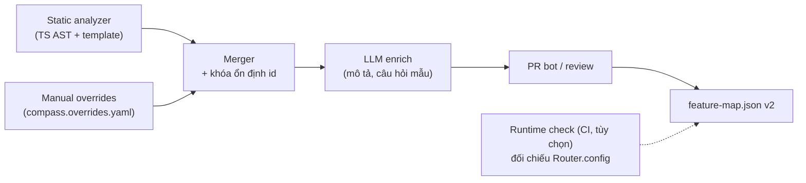

# WealthCompass – Plan kỹ thuật bản tổng quát (áp vào bất kỳ web Angular nào)

Cập nhật: 2026-10-03

Tài liệu này mở rộng [plan v1](technical-plan.md). Plan v1 đúng cho một web đầu tư cụ thể; bản này tách phần **nền tảng dùng chung** khỏi phần **đặc thù ngành**, để cùng một hệ thống gắn được vào web Angular khác (ngân hàng, bảo hiểm, ERP, admin, thương mại điện tử…) mà không viết lại.

## 0. Phạm vi đã chốt (2026-10-03)

| Quyết định | Nội dung | Hệ quả |
| --- | --- | --- |
| Mô hình triển khai | **Tự host**: mỗi khách chạy một bản riêng trong hạ tầng của họ | Không đa tenant, không RLS, không tính phí/hạn mức theo tenant; dữ liệu và LLM key nằm trong tay khách |
| Mức tích hợp | **Chỉ mức A**: có source và sửa được | Phân tích tĩnh là nguồn chính, được gắn `tourId`/`route.data`; không làm crawl hộp đen, không làm embed script |
| Angular tối thiểu | **v20** | Standalone là mặc định, control flow `@if/@for` và signals ổn định; không phải lo Angular cũ. Dải hỗ trợ `>=20 <24` |
| Xác thực | **Khách đăng nhập bằng JWT** | Backend xác minh JWT bằng JWKS của hệ thống đăng nhập (mục 6.2, cách 1); quyền lấy từ claim `roles` đã xác minh |
| Giai đoạn đầu | **Demo local trước, không Helm** | `docker compose`/Helm lùi sang sau; demo chạy bằng `npm run server` + `npm run demo` (xem [demo.md](demo.md)). Web đầu tiên là web tài chính |

**Lưu ý vòng đời phiên bản** (theo lịch phát hành công bố): Angular 20 hết LTS ngày 2026-11-28, Angular 21 hết LTS 2027-05-19, Angular 22 (7/2026) hỗ trợ đến 2028-06-30. Hỗ trợ "tối thiểu v20" vì thế chủ yếu để không loại khách chưa kịp nâng cấp; fixture CI ưu tiên 21 và 22.

**Ngoài phạm vi, để dành cho sau** (thiết kế ở các mục dưới không chặn đường mở rộng): SaaS đa tenant, crawl hộp đen (mức C), embed Web Component cho web không sửa được, Angular < 20, AngularJS.

## 1. Nguyên tắc thiết kế

1. **Hợp đồng trước, cài đặt sau.** Các thành phần nói chuyện qua 4 hợp đồng có version (mục 3). Thay một thành phần không phá thành phần khác.
2. **Ngành nghề là dữ liệu, không phải code.** Từ điển, guardrail, mẫu từ chối, quy tắc "chỉ người dùng được bấm" nằm trong *Domain Pack*. Bản đầu tư của v1 thành pack `finance-vn`.
3. **Không sửa app của khách ngoài phần tối thiểu.** Cài đặt chỉ *thêm* (provider, widget, `tourId`), mọi chú thích ngữ nghĩa có thể đặt ở `compass.overrides.yaml` thay vì động vào code nghiệp vụ.
4. **Không biết thì nói không biết.** Điểm nào quét không ra đều vào báo cáo độ phủ; agent chỉ dẫn tới thứ nằm trong Feature Map (giữ whitelist route/tourId của v1).
5. **An toàn là mặc định, không phải tùy chọn:** agent không có tool ghi/giao dịch; engine không click phần tử nhạy cảm. Cấu hình chỉ siết thêm, không nới được quy tắc nền.
6. **Lõi logic tách khỏi DI của Angular** (để test đơn vị dễ), nhưng chỉ phát hành adapter Angular; không đầu tư đường framework-agnostic trước khi có nhu cầu.

## 2. Plan v1 đang gắn cứng những gì và tổng quát hóa thế nào

| Giả định trong v1 | Vấn đề khi sang web khác | Cách xử lý |
| --- | --- | --- |
| `route.data.title/description/productType` chuẩn hóa | Web khác chưa có | Trích từ nhiều nguồn (menu, `title` của route, heading, LLM); bổ sung qua `compass.overrides.yaml` hoặc `route.data` do schematic đề xuất |
| `productType`: stock/bond/fund | Khái niệm của ngành đầu tư | Đổi thành `facets` tự do do Domain Pack định nghĩa |
| `requiredRoles` đọc từ guard | Guard là code tùy ý | Ánh xạ guard → quyền trong config; guard lạ ghi `unknownGuards` |
| Directive `[tourId]` trên mọi phần tử | Mất công gắn tay | Gắn `tourId` cho phần tử then chốt; phần còn lại dùng bộ chọn xếp tầng (mục 5.3) |
| Một bộ guardrail đầu tư | Chỉ đúng cho tài chính | Chính sách thuộc Domain Pack; `generic` có bộ tối thiểu |
| Tiếng Việt cố định | Khách khác dùng ngôn ngữ khác | `locale` trong config; prompt và mẫu từ chối theo locale |
| Backend dùng token phiên hiện có | Mỗi web một kiểu xác thực | Bộ xác minh token cấu hình được (mục 6.2) |

## 3. Bốn hợp đồng (viết trước, version hóa)

Đặt trong package `@wealthcompass/contracts` (JSON Schema + kiểu TypeScript sinh từ schema). Đổi hợp đồng theo semver; backend hỗ trợ N-1 để nâng cấp widget và backend không phải đồng bộ cùng lúc.

### 3.1 Feature Map v2

```jsonc
{
  "schemaVersion": "2",
  "appVersion": "2026.10.1",          // phiên bản web, để index theo bản phát hành
  "generatedAt": "2026-10-03T08:00:00Z",
  "features": [{
    "id": "fund.subscribe",            // ổn định giữa các lần build, xem mục 4.5
    "route": { "pattern": "/fund/subscribe/:fundId", "exampleParams": { "fundId": "VCBF-BCF" } },
    "title": "Đăng ký mua chứng chỉ quỹ",
    "description": "…",
    "keywords": ["mua quỹ", "CCQ"],
    "menuPath": ["Quỹ", "Giao dịch", "Mua"],
    "facets": { "productType": "fund" },
    "access": { "requires": ["fund_account"], "unknownGuards": [] },
    "targets": [{ "tourId": "fund-amount", "label": "Số tiền", "hint": "…",
                  "sensitivity": "normal" }],   // normal | user-only
    "sampleQuestions": ["mua quỹ ở đâu"],
    "provenance": { "source": ["static", "manual"], "reviewed": true,
                    "sourceRef": "src/app/fund/fund.routes.ts:12" }
  }],
  "coverage": { "routesFound": 84, "routesWithTitle": 71, "menuItemsMatched": 66, "warnings": [] }
}
```

### 3.2 Context protocol (widget → agent)

```jsonc
{ "route": "/fund/subscribe/VCBF-BCF", "routePattern": "/fund/subscribe/:fundId",
  "visibleTargets": ["fund-amount", "fund-submit"], "locale": "vi",
  "capabilities": ["fund_account"],
  "ui": { "hasOpenDialog": false, "viewport": "desktop" } }
```

Không bao giờ gửi giá trị trong ô nhập, số dư, danh mục, token.

### 3.3 Tool và event protocol (agent ↔ widget qua SSE)

Sự kiện: `text`, `navigate`, `highlight`, `start_tour`, `ask_user_to_act`, `handoff`, `done`. Widget trả `tool_result` với `status: ok | target_missing | blocked_user_only | route_denied | timeout`. Backend kiểm tra whitelist `route` và `tourId` theo Feature Map đang kích hoạt trước khi phát sự kiện.

Thêm so với v1: **`ask_user_to_act`** ("hãy bấm vào ô này") cho bước cần người dùng tự thao tác (mở dropdown, chọn tab, nhập OTP); tour tự tiến khi nhận được sự kiện thật của người dùng.

### 3.4 App config (`compass.config.ts`)

```ts
export default defineCompass({
  domainPack: '@wealthcompass/pack-generic',      // hoặc pack-finance-vn
  locale: 'vi',
  backend: { baseUrl: 'https://compass.internal.example.com' },
  identity: {
    // lấy quyền từ claim của token đã được backend xác minh
    capabilitiesClaim: 'roles',
  },
  access: { guards: { fundAccountGuard: { requires: ['fund_account'] } } },
  discovery: {
    entry: 'src/app/app.routes.ts',
    menu: 'src/app/layout/menu.config.ts',
    extraRoots: [],                               // thêm app/lib khác trong monorepo hoặc repo remote
  },
  safety: {
    userOnly: ['[data-sensitive]', 'input[type=password]', 'button[type=submit]'],
    blockedRoutes: ['/settings/security'],
  },
  pii: { patterns: ['phone-vn', 'national-id-vn'] },
  ui: { theme: { primary: '#0a7' }, position: 'bottom-right' },
});
```

## 4. Discovery: từ source ra Feature Map

Vì chỉ làm mức A, nguồn chính là **phân tích tĩnh trong repo của khách**, bổ sung bằng khai báo tay; xuất route lúc chạy chỉ dùng để đối chiếu độ phủ.



Thứ tự ưu tiên khi gộp từng trường: `manual > static > llm`.

### 4.1 Phân tích tĩnh

Dùng `ts-morph` trên TypeScript compiler API, không phụ thuộc phiên bản Angular cho phần route. Phải nhận đủ các kiểu khai báo đang tồn tại trong Angular 20+:

- Standalone: `provideRouter(routes)`, `bootstrapApplication(App, { providers })`, `ApplicationConfig`, `loadChildren: () => import('./x.routes').then(m => m.ROUTES)`, `loadComponent`.
- NgModule (vẫn gặp ở app cũ nâng cấp): `RouterModule.forRoot(routes)`, `forChild(routes)`.
- `Routes` khai báo ở file khác, spread (`...adminRoutes`), hàm tạo route, hằng số đường dẫn (`path: ROUTE_PATHS.fund`). Dùng type checker để resolve; không resolve được thì ghi cảnh báo, không đoán.
- `redirectTo`, `**`, `canMatch`, named outlet, `title` (tĩnh và resolver), `data`.

Template dùng `angular-html-parser` (không gắn với phiên bản compiler); lấy cấu trúc cần dùng: `routerLink`, heading, `label`, `button`, `aria-*`, `data-testid`, `tourId`. Phải parse được cả `@if/@for/@switch` lẫn `*ngIf/*ngFor`; phần không parse được bỏ qua kèm cảnh báo. (Có thể nâng cấp sang parser của chính `@angular/compiler` trong repo khách nếu độ chính xác không đủ, vì dải phiên bản đã hẹp 20–22.)

Menu, tìm theo thứ tự: (1) file cấu hình khai trong config; (2) heuristic mảng đối tượng có `route|path|link|url` + `label|title|name` + `children|items`; (3) `routerLink` trong `nav|aside|mat-nav-list|p-menu…`.

Guard → quyền: bảng `access.guards` trong config; guard chưa có trong bảng ghi `unknownGuards`, agent nói "màn hình này có thể cần thêm quyền".

Route tham số: cần `exampleParams` để tour chạy được; thiếu thì tính năng vẫn tìm thấy nhưng chỉ dẫn tới danh sách cha.

Monorepo/nhiều repo: `discovery.extraRoots` cho phép quét thêm lib và app remote (Module Federation, Nx); phần route của remote không có source trong repo host thì cần quét repo của remote đó.

### 4.2 Khai báo tay

`compass.overrides.yaml` nằm cạnh code: sửa tiêu đề, thêm từ khóa, ẩn route, gắn `sensitivity`, đặt `id` cố định. Nghiệp vụ chỉnh được mà không cần sửa code Angular; thay đổi đi qua pull request như code.

### 4.3 Làm giàu bằng LLM

Chỉ điền chỗ trống (mô tả, câu hỏi mẫu, từ khóa) cho feature chưa `reviewed`. Đầu vào là Feature Map đã có, không có dữ liệu người dùng; chạy bằng mô hình mà khách cấu hình (kể cả on-prem). Kết quả mở pull request vào file overrides cho người duyệt; không ghi thẳng vào Feature Map.

### 4.4 Hỗ trợ gắn `tourId`

`compass annotate` quét template, đề xuất danh sách phần tử nên có `tourId` (nút hành động chính, ô nhập chính, tab) kèm patch; người dùng duyệt rồi áp. Không tự ghi vào code. Phần tử nhạy cảm (nút xác nhận, OTP) được đề xuất `tourRole="user-only"`.

### 4.5 Khóa ổn định và đổi tên

`id` không được đổi khi route đổi tên, nếu không log, đánh giá, tour đã lưu đều mất. `id` lấy từ `data.compassId` hoặc overrides; nếu không có, sinh từ (component, route) và lưu vào `compass.lock.json` ngay lần quét đầu. Lần sau khớp theo cặp đó; cặp "mất – mới" nghi đổi tên thì cảnh báo trong CI.

### 4.6 Báo cáo độ phủ và đối chiếu runtime

`compass doctor` in: số route tìm thấy / có tiêu đề / có trên menu / có target; route không resolve được; guard chưa ánh xạ; template không parse được. Là tiêu chí nghiệm thu khi gắn vào một web.

Tùy chọn trong CI: một bài Playwright đăng nhập tài khoản kiểm thử, đọc `Router.config` công khai (không dùng API private) và so với kết quả quét tĩnh. Route có ở runtime mà thiếu ở tĩnh là lỗi của analyzer, được báo ngay.

## 5. Tầng chạy trên trình duyệt

### 5.1 Chia gói

| Gói | Nội dung | Phụ thuộc |
| --- | --- | --- |
| `@wealthcompass/contracts` | Schema và kiểu | Không |
| `@wealthcompass/core` | `TargetResolver`, `TourEngine`, `SseClient`, `ContextBuilder`, `PiiFilter`, `SafetyPolicy` (không dùng DI) | Không |
| `@wealthcompass/angular` | `provideCompass()`, `ChatWidgetComponent`, `[tourId]`, `RouterAdapter`, schematic `ng-add` | `@angular/*` peer `>=20 <24` |
| `@wealthcompass/cli` | `init`, `scan`, `annotate`, `doctor`, `publish`, `eval`, `tour:record` | Node |

### 5.2 Tương thích Angular 20+

- Biên dịch thư viện ở chế độ **partial compilation** (Angular Package Format), nên một bản build chạy được trên nhiều major trong dải peer.
- Widget và directive là **standalone**, dùng signals và `inject()`; cung cấp qua `provideCompass(config)` trong `app.config.ts`. App còn dùng NgModule vẫn dùng được vì `provideCompass` có thể đặt trong `providers` của root module; không viết riêng `CompassModule` trừ khi có khách cần.
- Phải chạy được với: zone.js và zoneless; SSR/hydration (mọi truy cập `window`/`document` bọc `isPlatformBrowser`); `HashLocationStrategy`; `<base href>` khác `/`; route theo locale (`/vi/...`).
- Chỉ dùng API công khai: `Router.navigateByUrl`, `Router.events`, `Router.config`. Không đụng thuộc tính private.
- Dải phiên bản rà lại mỗi năm; từ sau Angular 22 chu kỳ major là 12 tháng. CI có một job chạy fixture với bản `next`.

### 5.3 Phân giải phần tử và tự chữa

`TargetResolver` thử lần lượt:

1. `data-tour-id` / `[tourId]` (nguồn chính ở mức A)
2. `data-testid` / `data-cy` / `data-qa`
3. `id` ổn định (bỏ id sinh tự động kiểu `mat-input-3`)
4. Role + tên truy cập (`button "Đặt lệnh"`)
5. Nhãn `<label for>`, `aria-label`, `placeholder`

Quy tắc:

- Trả về `matchedBy`; không khớp thì **không highlight**, báo `target_missing` thay vì chỉ sai chỗ.
- Ở mức A, `tourId` mất là lỗi build của chính khách nên bộ phân giải xếp tầng chủ yếu là lưới an toàn; không đầu tư vân tay DOM/so khớp mờ ở giai đoạn đầu.
- Hỗ trợ phần tử trong overlay của CDK (`.cdk-overlay-container`) và `shadowRoot` mở. Iframe khác origin và shadow DOM đóng: không hỗ trợ, báo `target_unreachable`.
- Chờ phần tử bằng `MutationObserver` + timeout, không dùng `setTimeout` cố định; xử lý `@if` async và change detection chưa kịp render.

### 5.4 Tour engine

- `TourRenderer` là interface; mặc định cài bằng **Driver.js** (MIT, bản 1.8.x). Chưa xác minh được Driver.js xử lý shadow DOM/iframe, nên có thể thay renderer nếu gặp giới hạn. CSS của tour được cô lập bằng tiền tố hoặc Shadow DOM để không đụng CSS của web.
- Loại bước: `navigate`, `highlight`, `wait_for`, `ask_user_to_act`, `explain`. Mỗi bước có `onMissing: skip | stop | ask_agent`.
- Phần tử cần tương tác trước khi hiện (dropdown, tab, dialog): dùng `ask_user_to_act`, engine không tự click.
- Điều hướng qua `RouterAdapter`; guard chặn thì báo `route_denied`, agent giải thích cần quyền gì; xử lý redirect đăng nhập.
- Tour bị gián đoạn (đóng, reload, hết phiên) lưu trạng thái trong `sessionStorage` để tiếp tục.
- Hỗ trợ truy cập: `prefers-reduced-motion`, bàn phím, `aria-live`; z-index không đè dialog bảo mật của web.
- `tour:record`: mở app trong Playwright, người vận hành bấm qua các bước, công cụ ghi `tourId`/locator, đề xuất `label`/`hint`; người vận hành duyệt rồi lưu thành file tour.

### 5.5 An toàn phía client

`SafetyPolicy` hợp nhất theo thứ tự: quy tắc nền (không tắt được) + Domain Pack + `compass.config`. Mặc định coi là `user-only`, engine **không bao giờ** click/điền/focus:

- `input[type=password]`, ô OTP (`autocomplete=one-time-code`, tên chứa `otp`/`pin`), ô thẻ (`cc-*`).
- `button[type=submit]` và nút trong `<form>` trên route thuộc `blockedRoutes`.
- Phần tử gắn `data-sensitive` hoặc `sensitivity: user-only`.

Giao thức (3.3) không có tool click/điền/gửi form, nên kể cả prompt injection cũng không có đường thực thi.

## 6. Backend tự host

### 6.1 Triển khai

Một gói cho mỗi khách, chạy trong hạ tầng của họ:

- `docker compose` cho thử nghiệm và khách nhỏ; Helm chart cho Kubernetes.
- Thành phần: `api` (chat/SSE, tool-use), `worker` (indexing, eval), `postgres` + `pgvector`, tùy chọn `redis` (cache, rate limit), tùy chọn mô hình embedding/rerank chạy cục bộ.
- Migration schema chạy tự động và có thể lùi; có script sao lưu/khôi phục Postgres.
- Quan sát: log có cấu trúc, `/metrics` dạng Prometheus, trace OpenTelemetry; không gửi telemetry ra ngoài mạng khách theo mặc định.
- Mọi cấu hình bằng biến môi trường/secret của khách: LLM endpoint, khóa API, JWKS URL, danh sách origin.
- Phát hành theo semver kèm ghi chú nâng cấp; backend hỗ trợ widget N-1.

### 6.2 Xác thực người dùng cuối

Backend của chúng ta chạy cạnh app của khách nên dùng chính phiên hiện có, như v1. Cấu hình một trong ba cách:

1. **Xác minh JWT bằng JWKS** của hệ thống đăng nhập khách (khuyến nghị).
2. **Gọi introspection endpoint** của khách cho token opaque.
3. **Reverse proxy tin cậy:** gateway của khách xác thực rồi chuyển `X-User-Id`/`X-Capabilities` đã ký.

`capabilities` lấy từ claim đã xác minh (cấu hình `capabilitiesClaim`). Quyền ở đây chỉ để lọc kết quả cho gọn, **không phải ranh giới bảo mật**: guard và API của chính app mới chặn truy cập thật; việc lọc sai chỉ khiến chỉ dẫn tới màn hình mà người dùng không vào được (đã có xử lý `route_denied`).

Mọi kết nối kiểm `Origin` theo allowlist; rate limit theo người dùng.

### 6.3 Dữ liệu và index

- Bảng chính: `feature_map_versions`, `features`, `feature_embeddings (pgvector)`, `glossary_terms`, `domain_pack_versions`, `conversations` (đã ẩn danh), `feedback`, `eval_runs`.
- **Index theo phiên bản:** mỗi lần `publish` tạo version mới, chạy eval, đạt ngưỡng mới chuyển con trỏ `active`; rollback là đổi lại con trỏ.
- Thời hạn lưu log do khách đặt trong cấu hình; mặc định tối thiểu và có job xóa định kỳ.

### 6.4 LLM

- Lớp `LlmProvider` trừu tượng: API đám mây hoặc endpoint tương thích OpenAI chạy on-prem; khách chọn.
- Hai bậc mô hình: nhỏ cho phân loại đầu vào và viết lại câu hỏi, lớn cho agent. Cache ngữ nghĩa theo (version Feature Map, locale, quyền).
- Giới hạn token/ngày và câu/phút do khách đặt; vượt ngưỡng thì hạ cấp (tắt rerank, dùng mô hình nhỏ) thay vì lỗi cứng.

### 6.5 API

| Endpoint | Việc làm |
| --- | --- |
| `POST /v1/chat` (SSE) | Hội thoại, phát sự kiện theo giao thức 3.3 |
| `POST /v1/tool-result` | Widget báo kết quả bước tour |
| `POST /v1/feedback` | Thumbs, lý do |
| `POST /v1/telemetry` | Sự kiện tour/click (đã lọc) |
| `PUT /v1/admin/feature-map` | CI publish (khóa admin riêng) |
| `GET /v1/admin/eval/:run` | Kết quả eval trước khi kích hoạt |

### 6.6 Tìm kiếm

Hybrid vector + từ khóa như v1, thêm: từ điển thuật ngữ hai tầng (pack → của khách), chuẩn hóa viết tắt/không dấu trước khi tìm, lọc theo `capabilities` và `facets`, ngưỡng điểm lấy từ eval của chính khách (không dùng hằng số chung cho mọi miền).

## 7. Domain Pack

Gói dữ liệu có version, chọn trong `compass.config.ts`:

```
pack-finance-vn/
  pack.yaml            # tên, locale, phiên bản, tương thích contracts
  glossary.yaml        # CCQ = chứng chỉ quỹ, UTTB = ứng trước tiền bán …
  policy/
    topics.yaml        # chủ đề bị chặn: tư vấn đầu tư, dự đoán giá …
    refusals.vi.md     # mẫu từ chối đã duyệt
    disclaimers.vi.md
  safety.yaml          # selector user-only bổ sung (nút Đặt lệnh, Xác nhận)
  facets.yaml          # productType: stock | bond | fund | derivative
  prompts/             # system prompt theo vai trò
  eval/seed-questions.yaml
```

Hai pack khởi đầu: `pack-generic` (an toàn nền + glossary rỗng + vài câu hỏi seed chung) và `pack-finance-vn` (chuyển từ v1). Pack được kiểm schema khi cài và chạy eval seed trước khi kích hoạt. Pack ngành khác là dữ liệu và eval seed, không sửa code.

Chuyển từ v1: guardrail đầu tư → `pack-finance-vn/policy`; `productType` → `facets`; 7 tour ưu tiên (đặt lệnh, nộp/rút tiền…) → file tour mẫu của pack, khách ghi đè được.

## 8. CLI và quy trình gắn vào một web mới

Mục tiêu: một web Angular 20+ đạt "chat tìm được đường" trong **dưới nửa ngày**, tour thêm dần theo luồng.

```
npx @wealthcompass/cli init        # phát hiện cấu trúc, tạo compass.config.ts và overrides mẫu
npx @wealthcompass/cli scan        # quét tĩnh, sinh feature-map.json + lock, in báo cáo độ phủ
npx @wealthcompass/cli annotate    # đề xuất tourId cho phần tử then chốt
npx @wealthcompass/cli doctor      # kiểm tra phiên bản, CSP, router, guard chưa ánh xạ
npx @wealthcompass/cli publish     # đẩy Feature Map lên backend, kích hoạt nếu eval đạt
npx @wealthcompass/cli eval        # chạy bộ câu hỏi, in hit@3
npx @wealthcompass/cli tour:record # ghi tour bằng cách bấm trên app
```

`ng add @wealthcompass/angular` chỉ **thêm**: `provideCompass()` vào `app.config.ts`, widget vào component gốc (hoặc đăng ký qua Overlay để không đổi template), file config mẫu; in diff, không ghi đè file có sẵn, không nhận diện được cấu trúc thì in hướng dẫn thủ công thay vì tự sửa.

Quy trình:

1. `init` → chọn pack, khai `entry`/`menu`, nối với JWKS của khách.
2. `scan` + `doctor` → xử lý cảnh báo (ánh xạ guard, bổ sung overrides).
3. Viết 20–30 câu hỏi thật (hoặc dùng seed của pack) → `eval` đạt ngưỡng.
4. `publish` lên staging, bật widget cho nhóm nội bộ qua feature flag của khách.
5. `annotate` + `tour:record` cho 3–5 tour quan trọng, thêm vào E2E.
6. Mở rộng theo log "câu hỏi không tìm thấy".

## 9. Kiểm thử để chứng minh tính tổng quát

Tổng quát chỉ đáng tin khi có bằng chứng trên nhiều app khác nhau.

**Ma trận fixture** (app mẫu nhỏ, chạy trong CI):

| Fixture | Mục đích |
| --- | --- |
| Angular 21 + standalone + Material | Đường chính: `provideRouter`, `loadComponent` |
| Angular 20 + NgModule + PrimeNG | Đường NgModule, lazy module, bản thấp nhất |
| Angular 22 + zoneless + signals + control flow | Không phụ thuộc zone.js, template mới |
| Nx monorepo nhiều app/lib | Route khai trong lib, alias path, `extraRoots` |
| Hash routing + `<base href="/app/">` + route theo locale | Điều hướng và tour |
| SSR + hydration | Không vỡ khi render server |

Tùy chọn sau: Module Federation (host + 2 remote) để kiểm `extraRoots` và đối chiếu runtime.

**Kho kiểm thử thực tế:** thêm một số app Angular mã nguồn mở có UI phức tạp (admin template, RealWorld…) để có điểm không do mình viết.

**Chỉ số** (đo theo từng fixture, in ở CI):

- Độ phủ route: số route tìm đúng / số route thật (mỗi fixture có danh sách chuẩn).
- Độ phủ menu và độ chính xác `menuPath`.
- hit@3 trên ít nhất **hai bộ câu hỏi ngoài tài chính** (ví dụ ERP, thương mại điện tử), để không chỉnh tham số riêng cho tài chính.
- Tỷ lệ phần tử `user-only` bị engine chạm vào: bắt buộc bằng 0.
- Tour pass E2E trên mọi fixture.

**An toàn:** prompt injection trong `description` của Feature Map và trong text trang; token sai chữ ký/hết hạn; Origin ngoài allowlist; Domain Pack có chính sách xung đột với quy tắc nền (nền phải thắng).

## 10. Bảo mật bổ sung

| Rủi ro | Giảm thiểu |
| --- | --- |
| Prompt injection từ Feature Map hoặc nội dung trang | Coi là dữ liệu; chuẩn hóa, cắt độ dài; whitelist route/tourId; agent không có tool ghi |
| XSS qua text trong Feature Map hiển thị ở widget | Chỉ render text/markdown đã lọc, không `innerHTML` thô, `DOMPurify` với danh sách thẻ hẹp |
| CSP của web chặn widget | `doctor` kiểm tra `script-src`, `connect-src`, `style-src`; tài liệu hóa nonce; không dùng `eval` |
| Rò dữ liệu qua LLM | Lọc PII ở client và backend; mẫu PII theo pack/locale, khách bổ sung; khách chọn endpoint LLM (kể cả on-prem) |
| Gói bị can thiệp trong chuỗi cung ứng | Phát hành kèm checksum/chữ ký, khóa phiên bản trong lockfile |
| Backend tự host bị cấu hình sai | `doctor` cho backend: kiểm tra origin, JWKS, TLS, quyền DB, thời hạn lưu log |

## 11. Lộ trình điều chỉnh

Thứ tự thay đổi so với v1: dựng **hợp đồng và discovery tổng quát trước**, chatbot chạy được trên **hai web khác nhau** rồi mới làm tour sâu. Giả định 2 dev chính (1 Angular, 1 backend/AI), QA và nghiệp vụ bán thời gian. Ước tính khoảng **18 tuần** (v1 là 17 tuần cho một web), mỗi giai đoạn có tiêu chí thoát.

| Giai đoạn | Thời lượng | Nội dung | Tiêu chí thoát |
| --- | --- | --- | --- |
| **G0. Hợp đồng và khung** | ~2 tuần | `contracts`, monorepo, 3 fixture đầu (21 standalone, 20 NgModule, 22 zoneless), ADR | Schema được review; fixture chạy trong CI |
| **G1. Scanner** | ~3 tuần | Static analyzer, merger, lock id, overrides, `doctor`, `annotate`, đối chiếu runtime | Độ phủ route ≥ 95% trên cả fixture hiện có; chạy được trên 1 app thật |
| **Cổng 1** | | Pháp chế duyệt phạm vi, chốt nhà cung cấp LLM / endpoint on-prem | |
| **G2. Backend tự host + chatbot MVP** | ~5 tuần | Docker compose + Helm, xác thực JWKS, indexing theo version, hybrid search, agent, widget, `ng add`, `publish`/`eval` | Chat tìm đúng đường trên **2 web khác ngành**; hit@3 đạt ngưỡng; cài từ đầu bằng tài liệu trong < 1 ngày |
| **Cổng 2** | | Pilot nội bộ ổn | |
| **G3. Tour engine** | ~4 tuần | `TargetResolver`, `TourRenderer`, `ask_user_to_act`, `tour:record`, SafetyPolicy, E2E Playwright | Tour mẫu pass trên mọi fixture; 0 chạm `user-only` |
| **Cổng 3** | | | |
| **G4. Domain Pack, pilot, tài liệu** | ~4 tuần | Chuyển v1 thành `pack-finance-vn` + `pack-generic`, hướng dẫn vận hành tự host, pilot trên 2 web thật qua feature flag | KPI baseline; web thứ ba gắn vào trong < 1 ngày |

G2 và G3 có thể chồng một phần nếu thêm người. Không nên rút ngắn G0 vì sai hợp đồng là lỗi đắt nhất.

## 12. Quyết định kiến trúc (ADR)

| # | Quyết định | Lý do | Đánh đổi |
| --- | --- | --- | --- |
| 1 | Tự host, một bản cho mỗi khách | Khách giữ dữ liệu và LLM key; bỏ cả lớp đa tenant | Khách tự vận hành; mỗi nâng cấp phải đóng gói và hỗ trợ nhiều bản |
| 2 | Chỉ mức A (có source) | Phân tích tĩnh + `tourId` bền hơn crawl; tour an toàn hơn | Không phục vụ web không sửa được |
| 3 | Angular `>=20 <24`, thư viện partial compilation | Một bản build phủ nhiều major; bỏ gánh Angular cũ | Rà lại dải phiên bản mỗi năm; Angular 20 sắp hết LTS |
| 4 | Phân tích tĩnh bằng `ts-morph` + `angular-html-parser` | Không ràng buộc phiên bản Angular của khách | Tự viết heuristic; không hiểu mọi template phức tạp |
| 5 | Lõi logic tách khỏi DI, chỉ phát hành adapter Angular | Test đơn vị dễ, giữ đường mở rộng | Một lớp trừu tượng mỏng |
| 6 | Renderer tour qua interface, mặc định Driver.js | Có sản phẩm nhanh; thay được nếu gặp giới hạn | Phụ thuộc thư viện ngoài ban đầu |
| 7 | Quyền lấy từ claim đã xác minh, chỉ dùng để lọc, không phải ranh giới bảo mật | Guard là code tùy ý, không suy ra được | Có thể chỉ dẫn tới màn hình người dùng không vào được (đã có `route_denied`) |
| 8 | Chỉ đọc/hướng dẫn; không có tool ghi trong giao thức | Giảm bề mặt tấn công và rủi ro pháp lý | Không "điền giúp" |
| 9 | `tourId` do người duyệt gắn; không tự sửa im lặng | Tự sửa sai ở màn hình giao dịch nguy hiểm hơn tour lỗi | Tốn công duyệt |
| 10 | Mọi tùy biến đi qua config hoặc pack | Tránh nhánh code theo khách | Pack/config phải đủ biểu đạt; thiếu thì mở rộng schema |

## 13. Rủi ro

| Rủi ro | Ảnh hưởng | Giảm thiểu |
| --- | --- | --- |
| Heuristic phân tích tĩnh vỡ trên codebase "lạ" | Feature Map thiếu, trả lời sai | Báo cáo độ phủ bắt buộc, đối chiếu runtime, overrides tay |
| Tổng quát hóa quá sớm khi chưa có web thứ hai | Chậm, phức tạp thừa | Chỉ trừu tượng hóa các điểm ở mục 2; chốt bằng 2 web thật ở G2 |
| Mỗi khách vận hành một phiên bản khác nhau | Hỗ trợ khó | Widget N-1, migration tự động, `doctor` cho backend, ghi chú nâng cấp |
| Khách tự host cấu hình sai (origin, JWKS, TLS) | Lỗ hổng, lỗi khó chẩn đoán | Giá trị mặc định chặt, kiểm tra khi khởi động, tài liệu cài đặt |
| Phiên bản Angular mới đổi cách khai báo route/template | Analyzer và adapter hỏng | CI chạy fixture trên bản `next`; chỉ dùng API công khai |
| Khách đòi tùy biến riêng | Thành dịch vụ gia công | Mọi tùy biến đi qua config/pack; không nhánh code theo khách |

## 13b. Trạng thái hiện thực (2026-10-03)

Bản demo local đã hiện thực lát cắt dọc đầu tiên của kiến trúc ở trên, chạy được từ đầu đến cuối. Chi tiết chạy và giới hạn: [demo.md](demo.md).

| Hạng mục trong plan | Trạng thái | Ghi chú |
| --- | --- | --- |
| 3. Hợp đồng (`@wealthcompass/contracts`) | Có | Schema zod: Feature Map v2, ngữ cảnh, sự kiện SSE, cấu hình. Chưa sinh JSON Schema ra file |
| 4.1 Phân tích tĩnh, 4.2 overrides, 4.5 khóa ổn định, 4.6 báo cáo | Có | `ts-morph` + `angular-html-parser`; hiểu `loadComponent`/`loadChildren`, route con, guard kế thừa, `templateUrl`, component con qua `imports`, `@if/@for`. `compass.lock.json` giữ id khi đổi tên route |
| 4.3 LLM làm giàu | Có | Lệnh `enrich`: LLM soạn nháp `description`/`keywords`/`sampleQuestions` cho màn hình còn trống (từ chữ tĩnh trong template, theo lô, chỉ điền chỗ trống, khóa `llmDraft` buộc phải duyệt, `scan --strict` đỏ tới khi duyệt). `title` còn thiếu thì lấy từ nhãn menu. Thêm `tour:record` soạn nháp tour. Chưa làm: enrich dùng dữ liệu runtime, sinh `title` bằng LLM |
| 4.4 `annotate` | Có | Quét template, gợi ý `tourId` (tên `màn-hình-phần-tử`), tự đánh dấu `user-only` (chắc chắn / cần xem lại), thêm `TourIdDirective` vào component, xuất patch git; không tự sửa code. Test áp patch thật bằng `git apply` rồi `scan` thấy đúng id, chạy lại không còn gợi ý |
| 4.6 đối chiếu runtime | Chưa | |
| 5.1 `core`, `angular`, 5.3 `ng add` | Một phần | `core` + `angular` có; `provideCompass()`, widget, `[tourId]`, `TourService`. Chưa có schematic `ng add` và build ng-packagr (demo nạp thẳng source qua tsconfig paths) |
| 5.3 `TargetResolver`, 5.4 tour engine, 5.5 an toàn client | Một phần | Có `data-tour-id`/testid/id/aria-label, chờ bằng MutationObserver, bước `advanceOn: click`, tour qua nhiều route, `user-only`. Có `tour:record` (mục 8, chặn lần bấm vào phần tử user-only khi ghi). Chưa lưu trạng thái tour khi reload |
| 6.1 Triển khai tự host | Một phần | Chạy bằng npm; chưa có `docker compose`/Helm (đã hoãn) |
| 6.2 Xác thực JWT/JWKS | Có | Xác minh RS256 qua JWKS, kiểm issuer/audience; IdP giả lập chỉ để demo. Đã thử token `alg:none` giả mạo (bị từ chối) |
| 6.3 Dữ liệu, index theo phiên bản | Chưa | Feature Map nạp từ file và tự nạp lại khi đổi; chưa có Postgres/pgvector, version `active` |
| 6.4 LLM | Một phần | Client tương thích OpenAI, stream, tool-calling; preset DeepSeek (mặc định) và Gemini; chế độ dự phòng khi LLM lỗi. Đã chạy thật với DeepSeek V4 Flash (~2,7 giây/câu). Chưa có hai bậc mô hình, cache ngữ nghĩa, hạn mức token |
| 6.6 Tìm kiếm | Một phần | BM25 + từ điển đồng nghĩa + thưởng cụm từ + lọc quyền + ngưỡng điểm; chưa có embedding/rerank |
| 7. Domain Pack | Một phần | `packs/finance-vn` (glossary, topics chặn, mẫu từ chối, system prompt); chưa có `pack-generic`, chưa có seed eval |
| 9. Kiểm thử | Một phần | 44 test + 1 E2E Chrome tùy chọn (scanner, template, enrich, annotate, soạn nháp tour, gộp YAML, agent với LLM giả). Chưa có ma trận fixture nhiều phiên bản Angular, hit@3, Playwright |

**Phát hiện khi hiện thực**

- Xác thực quyền ở **backend**: server dùng `roles` từ JWT đã xác minh, không tin danh sách quyền client gửi trong ngữ cảnh. Đúng với ADR 7 (quyền chỉ để lọc) và chặn được việc client tự khai quyền để lấy tour của tính năng bị khóa (`/v1/tours/:id` trả 403).
- Câu hỏi "ở đâu/cách làm" chứa động từ như "đặt lệnh bán ở đâu" suýt bị chặn nhầm là "nhờ đặt hộ"; mẫu chặn phải yêu cầu từ "giúp/hộ" đi kèm. Đã có test.
- Route cha chỉ làm khung (có `children`) không phải là màn hình; target của khung (thanh tab dưới) được gán cho mọi route con, và route của bước tour lấy route đầu tiên chứa target đó. Engine chỉ điều hướng khi phần tử chưa hiện.
- Hạn mức LLM là rủi ro vận hành thật (khóa Gemini dùng thử đã hết tiền trả trước khi demo): chế độ dự phòng không chỉ là tính năng phụ mà cần có từ MVP.
- Tên model phải nằm trong cấu hình, không nằm trong code: `gemini-2.5-flash` đã không còn cho tài khoản mới (404). Mô hình suy luận (DeepSeek V4) có `reasoning_content` riêng nên client chỉ lấy `content`; có thể hạ `reasoning_effort` để nhanh hơn.
- Widget phải tự đóng gói tài nguyên: bản đầu phụ thuộc font Material Icons và CSS popover nằm trong app chủ; đã chuyển sang icon SVG nội bộ và `compass-theme.scss` để gắn vào web khác chỉ cần thêm hai dòng `styles`.
- `annotate` phải tự thêm `TourIdDirective` vào `imports` của component: gắn `tourId` mà thiếu directive thì Angular không báo lỗi (chỉ thành thuộc tính HTML thường) nên tour hỏng âm thầm. Đây là lý do patch sửa cả template lẫn file `.ts`. Đường dẫn trong patch phải dùng đường dẫn thật (macOS: `/private/var` khác `/var`), nếu không `git apply` từ chối.
- Heuristic nhạy cảm cần cụm từ thay vì từ đơn ("toan" trong "toàn thị trường" bị nhầm là thanh toán) và chỉ lấy tên hàm được gọi trong `(click)` (tên biến `selectingSell` không nói nút làm gì). Chạy thử trên web demo giảm cảnh báo giả từ 5 xuống 1.
- Gói `@wealthcompass/llm` dùng chung cho server và CLI (preset, tìm khóa an toàn, stream và không stream). Typecheck cho CLI lộ ra lỗi thật: scanner truyền sai tên tùy chọn của `angular-html-parser` v10 (`canSelfClose`, không phải `canSelfClosingTags`) nên thẻ component tự đóng `<app-x />` có thể nuốt phần tử sau nó; đã sửa và có test.
- Script chạy trong trình duyệt của `tour:record` phải là chuỗi JS thuần, và phải tự chờ `<html>` xuất hiện vì init script chạy trước khi có tài liệu; bản đầu bỏ qua im lặng nên không ghi được bước nào, chỉ lộ ra khi chạy với Chrome thật.
- Đẩy trạng thái "đang ghi" từ Node xuống trang thay vì để trang tự hỏi, vì bộ bắt click cần quyết định đồng bộ có chặn lần bấm nhạy cảm hay không.
- Model hay viết câu kết thúc hai lần (một lần trước, một lần sau khi gọi `offer_tour`); agent dừng ngay sau lượt đã có chữ kèm lệnh chỉ hiện nút.

## 14. Câu hỏi mở

Các câu hỏi v1 về pháp chế, LLM cloud/on-prem, dữ liệu ticket CSKH, nhóm pilot vẫn còn hiệu lực. Bổ sung:

- [ ] Web thứ nhất (tài chính) và web thứ hai (ngoài ngành) dùng để chứng minh tính tổng quát là web nào? Hai web đang ở Angular bao nhiêu và NgModule hay standalone?
- [x] Hệ thống đăng nhập của khách cấp JWT (đã chốt 2026-10-03); còn cần xác nhận có JWKS URL công khai không
- [x] Demo local trước, không Helm (đã chốt 2026-10-03); Kubernetes hay VM thuần sẽ hỏi lại khi có khách thật
- [ ] Khách có buộc LLM on-prem không, và mô hình on-prem nào hỗ trợ tool-use đủ tốt?
- [ ] Có cần ngôn ngữ ngoài tiếng Việt và tiếng Anh ở giai đoạn đầu không?
- [ ] Đổi tên sản phẩm cho nền tảng (WealthCompass mang nghĩa tài chính) và giữ tên cho pack `finance-vn`?
- [ ] Giấy phép và cách phân phối gói tự host (registry riêng, mã nguồn mở, hay đóng gói theo hợp đồng)?
